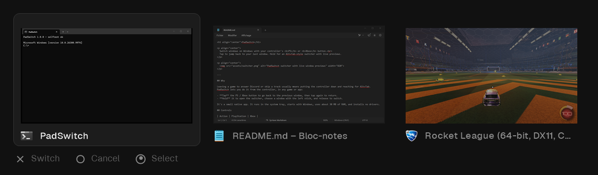

<h1 align="center">PadSwitch</h1>

<p align="center">
  Switch windows on Windows with your controller's <b>PS</b> or <b>Xbox</b> button.<br>
  Tap to jump back to your last window. Hold for an Alt+Tab-style switcher with live previews.
</p>

<p align="center">
  
</p>

---

## Why

Leaving a game to answer Discord or skip a track usually means putting the controller down and reaching for Alt+Tab. PadSwitch lets you do it from the controller, in any game or app:

- **Tap** the PS / Xbox button to go back to the previous window, then tap again to return.
- **Hold** it to open the switcher, choose a window with the left stick, and release to switch.

It's a small native app. It runs in the system tray, can start with Windows, uses about 30 MB of RAM, and installs no drivers.

## Controls

| Action | PlayStation | Xbox |
| --- | --- | --- |
| Previous window | Tap **PS** | Tap **Guide** |
| Open the switcher | Hold **PS** (300 ms) | Hold **Guide** |
| Move the selection | Left stick | Left stick |
| Switch | Release **PS**, or press **✕** | Release **Guide**, or press **A** |
| Cancel | **○** | **B** |

The D-pad is ignored on purpose, because many games bind it to something (quick chat in Rocket League, for example). While the switcher is open, the stick moves one card per push and stops at the last window instead of wrapping around.

## Supported controllers

| Controller | USB | Bluetooth | Read through |
| --- | :---: | :---: | --- |
| DualSense (PS5) | ✓ | ✓ | Raw Input |
| DualSense Edge | ✓ | ✓ | Raw Input |
| DualShock 4 (v1, v2, wireless adapter) | ✓ | ✓ | Raw Input |
| Xbox One, Series X\|S, Xbox 360 and XInput-compatible pads | ✓ | ✓ | XInput |

Controllers are picked up automatically when plugged in, reconnected or power-cycled. PadSwitch only **reads** the controller and shares it with the game: no virtual device and no exclusive access.

## Install

1. Download `PadSwitch.exe` from the [Releases](../../releases) page.
2. Run it. An icon appears in the notification area. That's it.

The executable isn't code-signed yet, so Windows SmartScreen may warn the first time: click **More info → Run anyway**. If you'd rather not trust a binary, [build it yourself](#build-from-source) in one command.

Requirements: Windows 10 (1903 or later) or Windows 11. .NET Framework 4.8 ships with both, so there's nothing else to install.

To launch it automatically, tick **Start with Windows** in the tray menu (current user only, `HKCU\…\Run`). Nothing is set up behind your back.

## Settings

Right-click the tray icon:

- **Controller detected / No controller detected**: quick status check.
- **Short press: previous window**: turn off if you only want the switcher.
- **Hold to open the switcher**: 200, 300 or 450 ms.
- **Start with Windows**
- **Show the switcher**: opens it without a controller (works with the mouse too).
- **Quit**

Settings live in `HKCU\Software\PadSwitch`. The interface follows your Windows language (English or French).

## Things to know

**Steam.** If Steam is running, the PS / Guide button can also open Steam or Big Picture. Turn off *Steam → Settings → Controller → Guide button focuses Steam*.

**Xbox Game Bar.** On Xbox controllers the Guide button opens the Game Bar by default. Turn off *Settings → Gaming → Xbox Game Bar → Open Xbox Game Bar using this button on a controller*.

**DS4Windows / HidHide.** If HidHide hides your controller, add `PadSwitch.exe` to its list of allowed applications. If DS4Windows emulates an Xbox controller, both the real pad and the virtual one are seen and merged, so the button still fires only once.

**The game still sees the stick.** PadSwitch reads the controller alongside the game. While the switcher is open, moving the stick also reaches the game.

**Exclusive fullscreen.** The switcher draws above borderless and windowed games. Some games in true exclusive fullscreen can hide it. A tap still switches windows.

**Overlays are skipped.** Always-on-top windows without a title bar (stat trackers, recording overlays, the Discord overlay…) are never offered as a target.

## How it works

- **Input**: Sony controllers are read with Windows Raw Input in background mode (`RIDEV_INPUTSINK`), straight from their HID reports. Xbox controllers are polled through XInput (`XInputGetStateEx`, the only call that exposes the Guide button).
- **Window list**: the same rules as Alt+Tab, in most-recently-used order. Cloaked, tool, owned and click-through windows are left out.
- **Previews**: live DWM thumbnails composited by Windows, so there's no screen capture and no CPU cost while the switcher is closed.
- **Switching**: `SetForegroundWindow` with a brief input attach to the current foreground thread, falling back to `SwitchToThisWindow`, the call Alt+Tab itself relies on. No keystrokes are ever simulated.
- **Display**: per-monitor DPI aware. The switcher opens on the monitor of the active window, scales to that monitor (100 %, 125 %, 150 %…) and shrinks to fit when many windows are open.
- **Animation**: frames are paced on the display refresh (`DwmFlush`) from a separate thread, so controller input is never delayed by drawing.

No network access, no telemetry. Nothing is written besides the settings key and the optional startup entry.

## Build from source

No SDK needed. Windows already ships with the C# compiler for .NET Framework 4.8:

```bat
build.bat
```

This produces `PadSwitch.exe` next to the sources. Everything is in [`PadSwitch.cs`](PadSwitch.cs) (about 850 lines).

`build.bat dev` adds a few development flags. They're left out of the released exe so it never contains screen-capture code:

| Flag | What it does |
| --- | --- |
| `--selftest` | Checks the report parsers for every controller and prints `selftest ok` (also in the release build). |
| `--listen` | Prints controller events for 8 seconds without switching anything. |
| `--lang en` | Forces the UI language (put it first). |
| `--snapshot out.png [scale] [processes]` | Renders the switcher off-screen, for example at `1.5` for 150 %, optionally limited to some processes (`notepad,explorer`). |
| `--demo out.png` | Opens the switcher on screen for one second and captures it. |

## Credits

- UI font: [Geist](https://github.com/vercel/geist-font) by Vercel, under the SIL Open Font License ([`fonts/OFL.txt`](fonts/OFL.txt)).

## License

[MIT](LICENSE)
